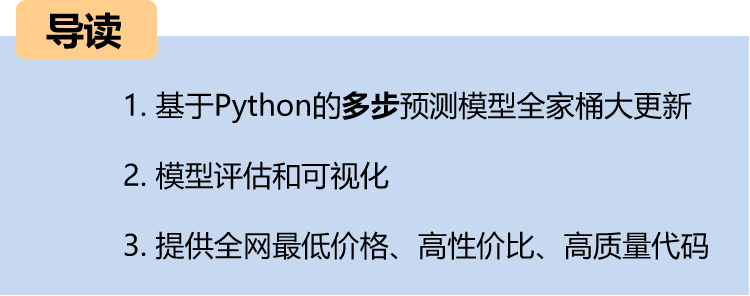
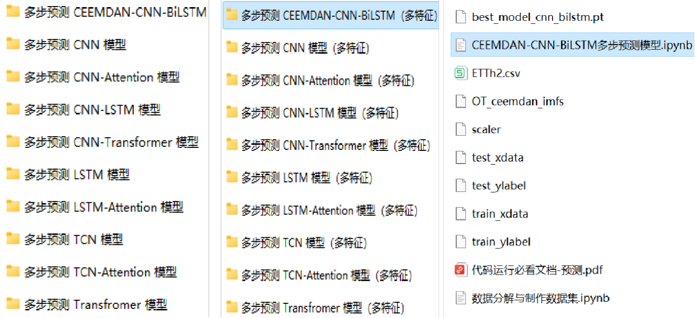
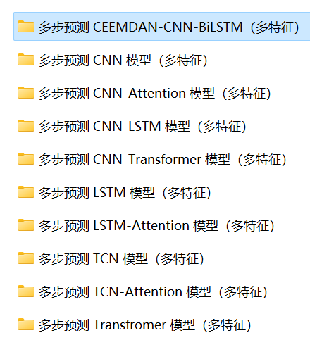
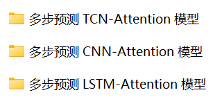
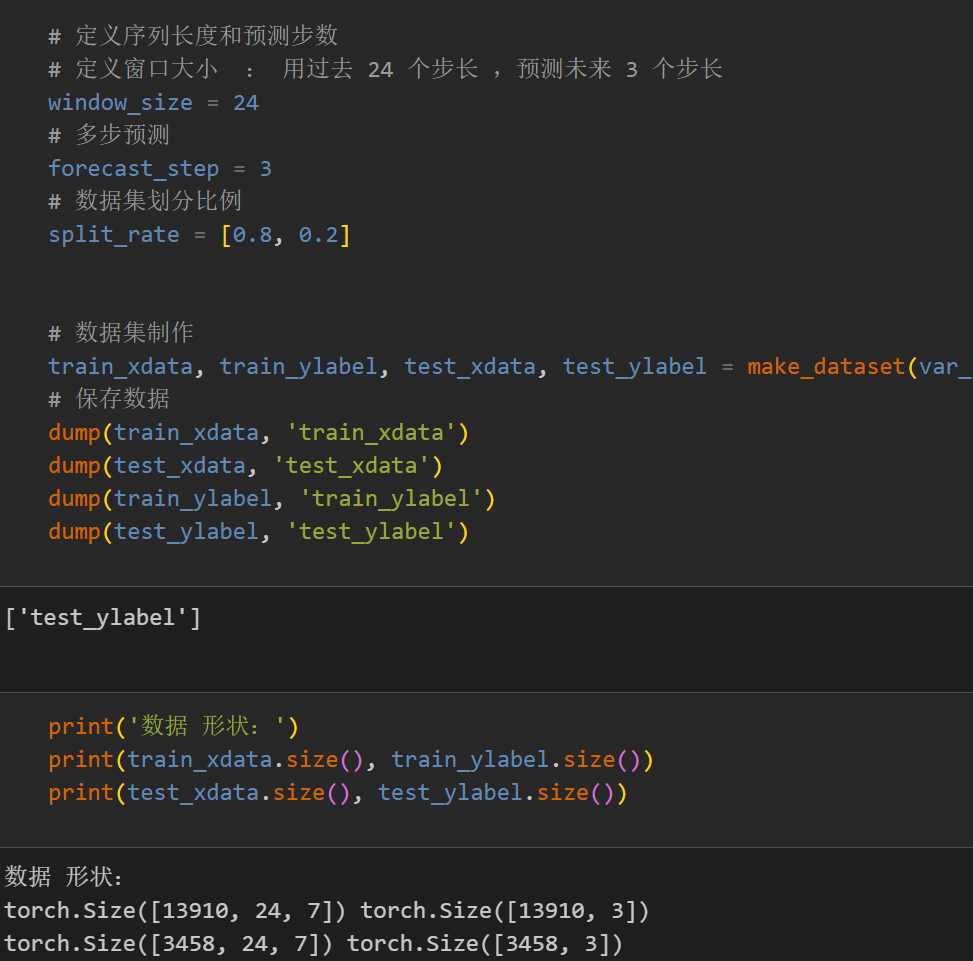
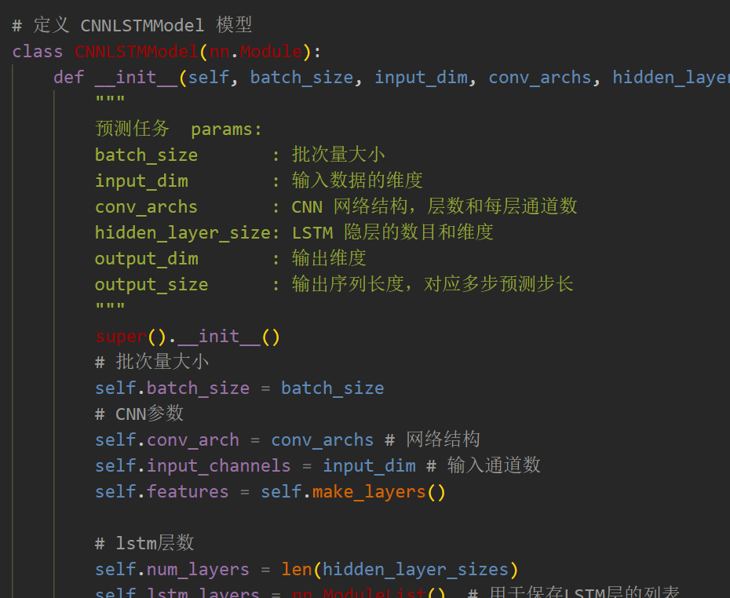
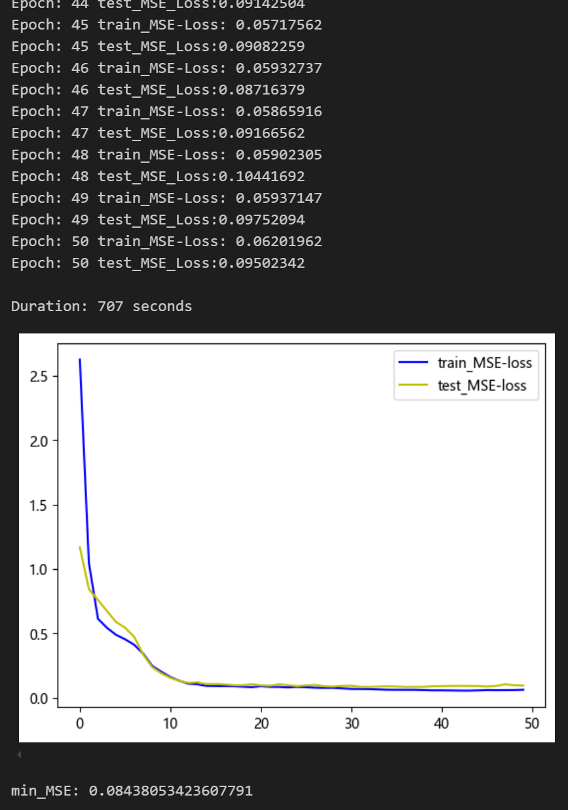
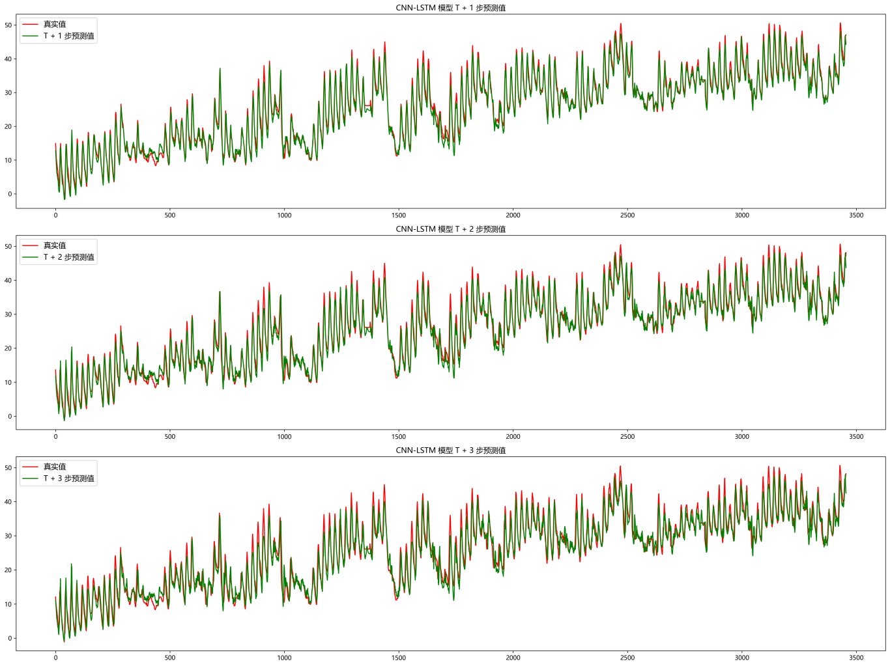
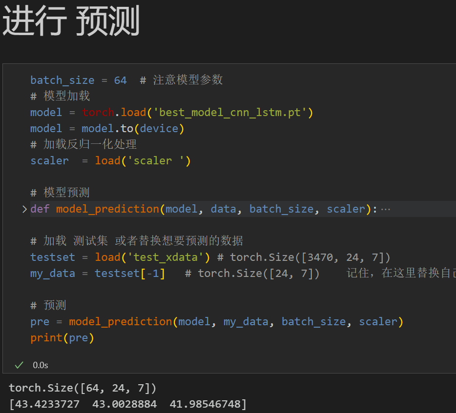
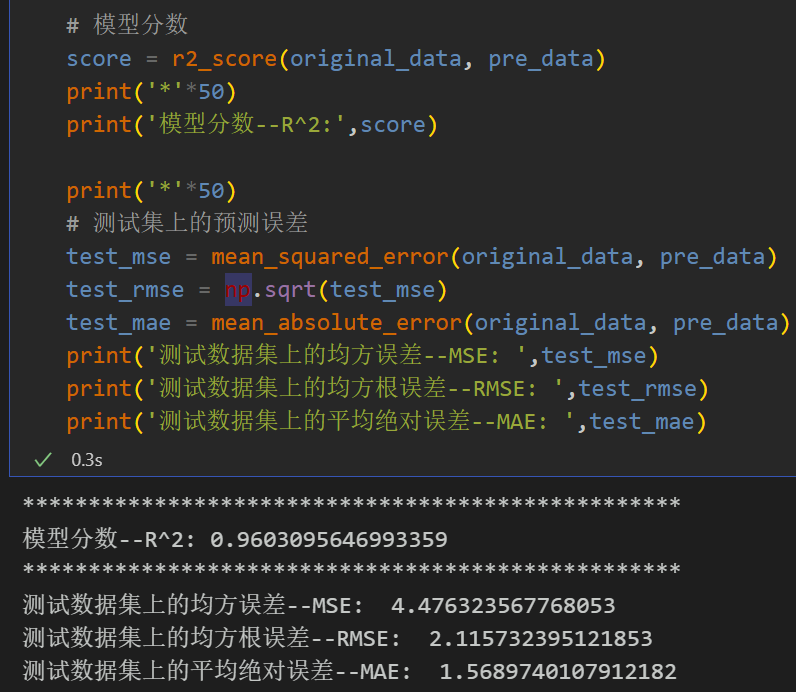

# Large Updates to Multi-Step Prediction Models

Including complete process data code processing: multi-step prediction dataset creation, data loading, model definition, parameter setting, model training, model testing, prediction visualization, multi-step prediction, model evaluation.
● Environment Framework: Python 3.9, PyTorch 1.8 and above can be run.
● Supplementary documents: detailed tutorials on environmental configuration and installation, as well as documentation on models and parameters.
● Usage Object: Paper requirements, graduation design requirements.
● Code Guarantee: The code comments are detailed and ready to run.
Update introduction:
1. Add a multi-feature, multi-step prediction model:
2. Additional Attention Prediction Model:
Including complete process data code processing:
Multi-step prediction dataset creation, data loading, model definition, parameter setting, model training, model testing, prediction visualization, model evaluation, multi-step prediction (how to load a trained model for external prediction).
Code and file introduction:
Preface
This paper introduces a multi-feature-multi-step prediction model based on the CNN-LSTM network, which is introduced based on the previous introduction of power transformers (dataset attached at the end).
The detailed introduction to the power transformer dataset can be found in the following text:
Introduction to the Power Transformer Dataset and Preprocessing
1 Data Preprocessing and Visualization of Electric Power Transformers
1.1 Import data
1.2 Multi-feature multi-step prediction preprocessing
2. Multivariate multi-step prediction model based on CNN-LSTM
2.1 Define the CNN-LSTM network model
\t  
2.2 Set parameters and train the model
50 epochs, MSE is 0.08438. The multi-step prediction model of CNN-LSTM has significant predictive effects. The model can fully extract the spatiotemporal features of sequences, converges quickly, and performs excellently with high accuracy in predictions. By appropriately adjusting the model parameters, further improvements in model predictive performance can be achieved.
\tNote: Adjust parameters.
1. Increase the number of CNN layers and channels per layer appropriately;
2. Change the number of LSTM layers and the number of neurons per layer, increasing more epochs (note to prevent overfitting);
3. Adjust the sliding window length (set an appropriate window length).
3. Results Visualization and Prediction, Model Evaluation
3.1 Visualize prediction results
3.2 Load the model for prediction
3.3 Model evaluation
Previously interesting content:
Time Series Forecasting: Analysis and comparison of LSTM, ARIMA, Holt-Winters, SARIMA models
Wind Speed Forecasting (I) Data Set Introduction and Preprocessing
Wind Speed Forecasting (II) EMD-LSTM Model Based on Pytorch
Wind Speed Forecasting (III) EMD-LSTM-Attention Model
Wind Speed Forecasting (IV) EMD-Transformer Model Based on Pytorch
Wind Speed Forecasting (V) EMD-CNN-LSTM Model Based on Pytorch
Wind Speed Forecasting (VI) EMD-CNN-GRU Parallel Model Based on Pytorch
CEEMDAN + Combination Forecast Model (BiLSTM-Attention + ARIMA)
CEEMDAN + Combination Forecast Model (CNN-LSTM + ARIMA)
CEEMDAN + Combination Forecast Model (Transformer - BiLSTM + ARIMA)
CEEMDAN + Combination Forecast Model (CNN-Transformer + ARIMA)
Multi-feature variable sequence forecasting (I) — CNN-LSTM Wind Speed Forecast Model
Multi-feature variable sequence forecasting (II) — CNN-LSTM-Attention Wind Speed Forecast Model
Multi-feature variable sequence forecasting (III) — CNN-Transformer Wind Speed Forecast Model
Multi-feature variable sequence prediction (IV) Transformer-BiLSTM wind speed prediction model
Multi-feature variable sequence prediction (V) CEEMDAN+CNN-LSTM wind speed prediction model
Multi-feature variable sequence prediction (VI) CEEMDAN+CNN-Transformer wind speed prediction model
Prediction model based on the SSA of the crow optimization algorithm: CEEMDAN-BiLSTM-Attention
Prediction model based on the SSA of the crow optimization algorithm: CEEMDAN-Transformer-BiGRU
Superior predictive model: Secondary decomposition-combination prediction
Multi-feature variable sequence prediction (VII) CEEMDAN+Transformer-BiLSTM prediction model
Multi-feature variable sequence prediction (VIII) Prediction model based on the SSA of the crow optimization algorithm: CEEMDAN-SSA-BiLSTM
Multi-feature variable sequence prediction (11) Prediction model based on Pytorch's TCN-GRU
VMD + CEEMDAN secondary decomposition, CNN-LSTM prediction model
VMD + CEEMDAN secondary decomposition, CNN-Transformer prediction model
VMD + CEEMDAN secondary decomposition, Transformer-BiGRU prediction model
Prediction model based on the SSA of the crow optimization algorithm - code family kit
Introduction to power transformer dataset and preprocessing
 | Sci-Tech 1st Class High Innovation Predictive Model!
END

## Images

<!-- PAYMENT_BLOCK -->

## Get this dataset

- Payment link (Stripe): [Buy now](https://buy.stripe.com/3cs8yP7sY87d0vu9AB)
- Payment QR code: 

<!-- /PAYMENT_BLOCK -->
